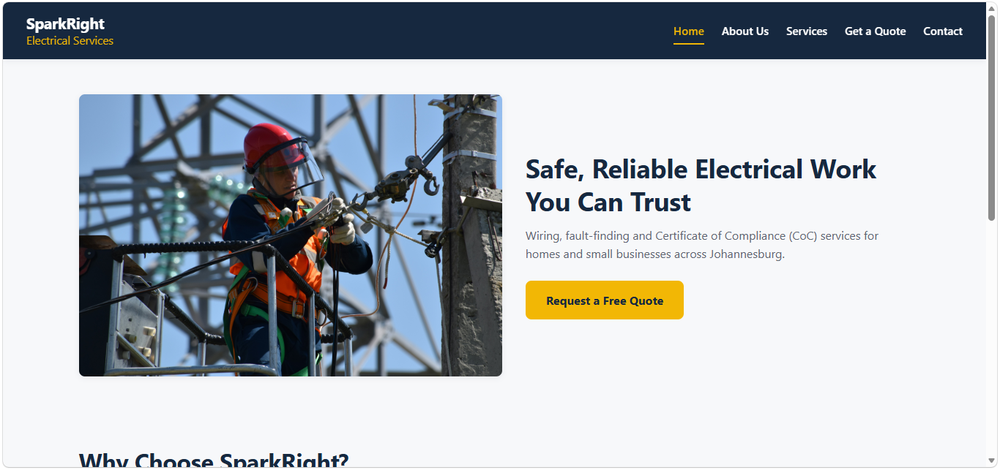
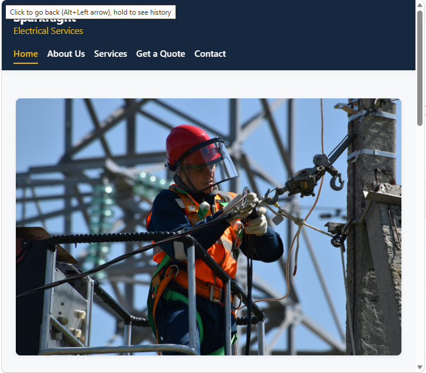
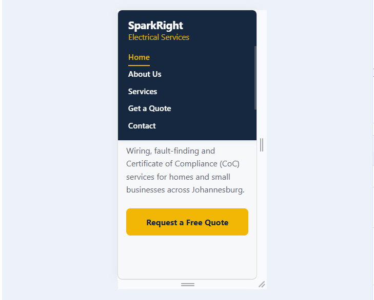

# SparkRight Electrical Services - Website Project

## Student Information
- **Name:** Mpho Mbele
- **Student Number:** ST10509066
- **Group:** 1
- **Module:** Web Development (WEDE5020)
- **Institution:** Rosebank International

## Project Overview
This repository contains the website build for SparkRight Electrical Services, a fictional residential and small commercial electrical contracting business based in Johannesburg, created as the target organisation for this assignment. SparkRight was founded in 2021 by a qualified electrician and has grown through word-of-mouth referrals, completing wiring, fault-finding, and Certificate of Compliance (CoC) work for homeowners and small businesses across Gauteng.

The project is being built across three parts:

- **Part 1: HTML foundation** - project planning, content research, sitemap, wireframes, and static HTML structure.
- **Part 2: CSS styling** - responsive, branded visual design (current stage).
- **Part 3: JavaScript functionality** - form validation and interactivity.

## Website Goals and Objectives
**Primary Goal:** Generate qualified leads by making it easy for potential customers to request a quote or book a call-out online, reducing reliance on word-of-mouth alone.

**Key Performance Indicators (KPIs):**
- Number of quote requests submitted per month.
- Average response time to enquiries.
- Percentage of website visitors who submit an enquiry form.

## Key Features and Functionality
- Homepage with a clear call-to-action to request a quote and a summary of services.
- Services page detailing wiring, fault-finding, CoC inspections, and emergency call-outs, with indicative pricing.
- Online enquiry/quote-request form capturing job type, location, and preferred contact method.
- About Us page with company history, mission, vision, and team profiles.
- Contact page with phone, WhatsApp, email, multiple service-area maps, and a contact form.

## Timeline and Milestones

| Week | Milestone |
|---|---|
| 1-2 | Project planning, proposal approval, content/image sourcing |
| 3-4 | HTML structure and page linking (Part 1) |
| 5-7 | CSS styling and responsive design (Part 2) |
| 8-9 | JavaScript functionality and testing (Part 3) |
| 10 | Final testing, debugging, and submission |

## Part 1 Details - Building the Foundation
Part 1 covers project initiation and planning, and includes:

- Two website project proposals submitted for lecturer approval (SparkRight Electrical Services approved as the target organisation).
- Content research and sourcing: original page copy written for SparkRight, plus legally-sourced free-license images (see `content-sourcing-log.md`).
- File and folder structure: `index.html`, `about.html`, `services.html`, `enquiry.html`, `contact.html` at the root, with `css/`, `js/`, `images/`, `content/`, and `wireframes/` subfolders.
- Low-fidelity wireframes for all five pages (`wireframes/`).
- Sitemap showing site structure (`wireframes/sitemap.svg`).
- Semantic, commented HTML for all five pages with a consistent site-wide navigation menu.

## Part 2 Details - Designing the Visuals
Part 2 covers CSS styling and responsive design, and includes:

- A single external stylesheet (`css/style.css`) linked from all five HTML pages.
- A CSS reset and base styles (font family, colours, spacing defaults) applied site-wide.
- A consistent typography scale (`h1`-`h4`, body text) using relative units (`rem`).
- Flexbox for the header/navigation, CSS Grid for the hero section, service cards, and team member layout.
- Visual styling (colour, borders, box-shadow) on cards, buttons, and form fields, with `:hover`, `:focus`, and `:active` states on all interactive elements.
- Responsive design with three breakpoints (1024px, 768px, 480px): multi-column layouts collapse to single-column on smaller screens, navigation stacks vertically on mobile, and buttons go full-width on small screens.
- Tested across desktop, tablet, and mobile widths using browser DevTools device emulation - see screenshots below.

### Screenshot Evidence

**Desktop:**

**Tablet:**

**Mobile:**

## Sitemap
See `wireframes/sitemap.svg` for the full visual sitemap. Site structure summary:

- Home (index.html)
  - About Us (about.html)
  - Services (services.html)
  - Get a Quote (enquiry.html)
  - Contact (contact.html)

All pages share the same header, navigation, and footer. The Services page also links directly to the Get a Quote page as a call-to-action.

## Changelog
- **7 August 2026** - Project proposals drafted for two target organisations (SparkRight Electrical Services and Crumbs & Co Artisan Bakery).
- **14 August 2026** - SparkRight Electrical Services approved by lecturer as the chosen organisation. Sitemap, wireframes, file structure, and initial HTML pages for Part 1 completed. Content research and sourcing completed (original text content + free-license images logged).
- **18 September 2026** - Created `css/style.css` and linked it from all five HTML pages. Implemented CSS reset, base styles, typography scale, Flexbox/Grid layout for header, hero, service cards, and team section, visual styling with hover/focus/active states on all interactive elements, and responsive breakpoints at 1024px/768px/480px. Captured desktop, tablet, and mobile screenshots as evidence (see Screenshot Evidence above).

## References
This project follows the Part 1 and Part 2 module briefs (The Independent Institute of Education, 2026a; 2026b) for structure and CSS/responsive requirements. Hero and team images are free-license stock photography sourced from Pexels (Pexels, n.d.a; n.d.b).

The Independent Institute of Education (Pty) Ltd. 2026a. WEDE5020: Web Development (Introduction) - Part 1: Building the Foundation, Project Initiation and Planning. Unpublished module manual. Johannesburg: IIE Rosebank College.

The Independent Institute of Education (Pty) Ltd. 2026b. WEDE5020: Web Development (Introduction) - Part 2: Designing the Visuals, CSS Styling and Responsive Design. Unpublished module manual. Johannesburg: IIE Rosebank College.

Pexels. n.d.a. Electrician. [Online]. Available at: https://www.pexels.com/photo/photo-of-a-person-s-hands-cutting-a-green-cable-7285975/ [Accessed: 14 August 2026].

Pexels. n.d.b. Electrical panel. [Online]. Available at: https://www.pexels.com/photo/electrical-wires-connected-on-conductors-7541342/ [Accessed: 14 August 2026].

---

## Part 3 — Enhancements, SEO, Forms & Security

### 1. Interactive Elements & JavaScript Enhancements
- **Gallery & Accessible Lightbox Viewer (js/lightbox.js):** Built a native <dialog> image viewer with smooth transitions. Features accessible controls, keyboard navigation (Left/Right arrow keys, Escape), and backdrop-click dismissal.
- **Dynamic Content & Filtering (js/search.js):** Added dynamic content search/filtering for services and project listings, allowing real-time query matching without full page reloads.
- **Interactive Map Integration:** Integrated interactive map containers with location pin fallbacks on contact and location sections.

### 2. Search Engine Optimization (SEO)
- **On-Page SEO:**
  - Standardized <title> tag naming patterns across all pages (Page Name | SparkRight Electrical Solutions).
  - Added target-keyword meta descriptions (<meta name="description">) and meta keywords across every HTML page.
  - Optimized heading hierarchy (<h1> down to <h3>) for structural search engine readability.
  - Expanded descriptive lt attributes on all images and defined explicit width and height properties to improve Cumulative Layout Shift (CLS).
- **Off-Page & Technical SEO:**
  - Created 
obots.txt specifying crawler instructions and pointing directly to the sitemap.
  - Created sitemap.xml mapping canonical URLs for indexing across all site routes.
  - Included canonical link tags (<link rel="canonical" href="...">) across all HTML documents.

### 3. Form Validation & AJAX Processing
- **Enquiry Form (enquiry.html):** Validates required user inputs and dynamically outputs calculated instant responses regarding service cost estimates, booking timelines, and staff availability.
- **Contact Form (contact.html & js/forms.js):** Fully integrated background asynchronous submission using etch() via FormSubmit. Displays on-page status indicators (Sending, Success message with customer name, and Error messaging) with an interactive mailto: fallback button if network issues arise.

### 4. Security & Deployment Headers
- Configured security headers inside ercel.json (X-Frame-Options: DENY, X-Content-Type-Options: nosniff, Referrer-Policy: strict-origin-when-cross-origin, Permissions-Policy).
- Enforced 
el="noopener noreferrer" attributes across all external hyperlinks (	arget="_blank").

---

## Part 3 Changelog

| Date | Category | Summary of Change / Feedback Correction | Impact / Files Affected |
| :--- | :--- | :--- | :--- |
| **2026-11-01** | *Part 2 Feedback* | Fixed structural alignment issues on service cards and corrected color contrast ratios to meet WCAG AA standards. | css/style.css |
| **2026-11-01** | *Part 2 Feedback* | Corrected responsive navigation breakpoint layout on mobile devices. | css/style.css, js/main.js |
| **2026-11-02** | *Technical SEO* | Set canonical domain URLs across all .html pages, 
obots.txt, and sitemap.xml. | *.html, 
obots.txt, sitemap.xml |
| **2026-11-02** | *Security* | Added ercel.json security headers and appended 
el="noopener noreferrer" to all target external links. | ercel.json, *.html |
| **2026-11-02** | *Interactivity* | Implemented zero-dependency modal lightbox viewer for image gallery on About page. | js/lightbox.js, css/style.css, bout.html |
| **2026-11-02** | *Forms & AJAX* | Implemented asynchronous AJAX submission via etch() API with response feedback and fallback mailto handling. | js/forms.js |

---

## References & Bibliography
1. Mozilla Developer Network (MDN). (2026). *HTMLDialogElement & Web Accessibility Standards*. Available at: https://developer.mozilla.org/
2. FormSubmit API. (2026). *FormSubmit Documentation & AJAX Endpoints*. Available at: https://formsubmit.co/
3. Google Search Central. (2026). *SEO Starter Guide: Sitemap.xml & Robots.txt Best Practices*. Available at: https://developers.google.com/search/docs
4. WebAIM. (2026). *Contrast and Color Accessibility Criteria*. Available at: https://webaim.org/